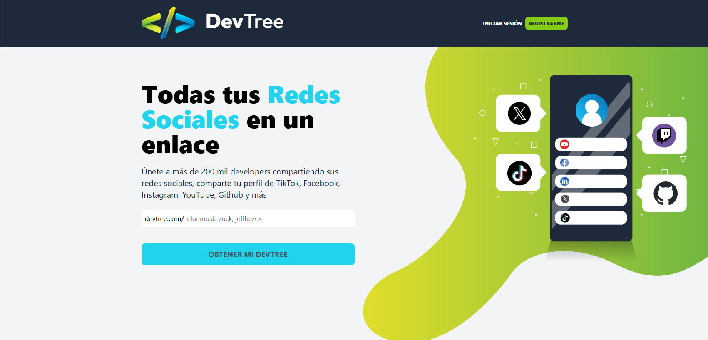

# 🌳 DevTree – Frontend

Interfaz web de **DevTree**, una aplicación tipo *link in bio* donde cada usuario puede reunir todas sus redes sociales en un solo enlace público (por ejemplo, `devtree.com/tu-usuario`).

Este repositorio contiene el cliente, construido con **React**, **TypeScript**, **Vite** y **Tailwind CSS**, que consume la API del backend.

> 🔗 El backend de este proyecto está en [devtree_backend](https://github.com/SuemyDzib/devtree_backend).



## ✨ Características

- **Búsqueda de handle** desde la página de inicio para saber si un nombre de usuario está disponible, con acceso directo al registro.
- **Registro e inicio de sesión** con validación de formularios; el token se guarda en LocalStorage.
- **Panel de administración** protegido, accesible solo con sesión iniciada.
- **Gestión de redes sociales**: Facebook, GitHub, Instagram, X, YouTube, TikTok, Twitch y LinkedIn. Cada enlace se activa o desactiva con un interruptor y se valida que la URL sea correcta.
- **Ordenar enlaces arrastrando y soltando** en la vista previa del perfil.
- **Edición de perfil**: handle, descripción e imagen de perfil.
- **Vista previa en tiempo real** de cómo se verá el perfil público.
- **Perfil público** en `/:handle`, con página de "usuario no encontrado" cuando no existe.
- **Notificaciones** de éxito y error con Sonner.

## 🛠️ Tecnologías

- [React 18](https://react.dev/) con [TypeScript](https://www.typescriptlang.org/)
- [Vite](https://vitejs.dev/) como herramienta de desarrollo y build
- [React Router](https://reactrouter.com/) para la navegación
- [TanStack Query](https://tanstack.com/query) para el manejo de datos del servidor
- [React Hook Form](https://react-hook-form.com/) para formularios y validaciones
- [dnd kit](https://dndkit.com/) para arrastrar y soltar
- [Tailwind CSS](https://tailwindcss.com/), [Headless UI](https://headlessui.com/) y [Heroicons](https://heroicons.com/)
- [Axios](https://axios-http.com/) para las peticiones HTTP
- [Sonner](https://sonner.emilkowal.ski/) para las notificaciones

## 📋 Requisitos

- [Node.js](https://nodejs.org/) 18 o superior
- El [backend de DevTree](https://github.com/SuemyDzib/devtree_backend) corriendo localmente o desplegado

## 🚀 Instalación y uso

1. Clona el repositorio:

   ```bash
   git clone https://github.com/SuemyDzib/devtree_frontend.git
   cd devtree_frontend
   ```

2. Instala las dependencias:

   ```bash
   npm install
   ```

3. Crea un archivo `.env.local` a partir del ejemplo e indica la URL del backend:

   ```bash
   cp .env.example .env.local
   ```

   ```env
   VITE_API_URL=http://localhost:4000
   ```

4. Inicia el servidor de desarrollo:

   ```bash
   npm run dev
   ```

5. Abre en tu navegador la URL que muestra la terminal (por defecto `http://localhost:5173`).

> Asegúrate de que la variable `FRONTEND_URL` del backend coincida con la URL del frontend; de lo contrario, las peticiones serán bloqueadas por CORS.

### Scripts

| Comando           | Descripción                                              |
| ----------------- | -------------------------------------------------------- |
| `npm run dev`     | Inicia el servidor de desarrollo con recarga en caliente |
| `npm run build`   | Revisa tipos y genera la versión de producción en `dist/` |
| `npm run preview` | Sirve localmente la versión de producción generada       |
| `npm run lint`    | Analiza el código con ESLint                             |

## 🗺️ Rutas

| Ruta              | Descripción                                    | Protegida |
| ----------------- | ---------------------------------------------- | :-------: |
| `/`               | Inicio con buscador de handle                  |           |
| `/auth/login`     | Inicio de sesión                               |           |
| `/auth/register`  | Registro de cuenta                             |           |
| `/admin`          | Gestión de enlaces a redes sociales            |    ✅     |
| `/admin/profile`  | Edición de perfil e imagen                     |    ✅     |
| `/:handle`        | Perfil público de un usuario                   |           |
| `/404`            | Usuario no encontrado                          |           |

## ☁️ Despliegue

El archivo `public/_redirects` redirige todas las rutas a `index.html`, lo que permite que React Router funcione al desplegar en plataformas como [Netlify](https://www.netlify.com/). Recuerda configurar la variable `VITE_API_URL` en la plataforma con la URL de tu backend en producción.

## 👤 Autor

Desarrollado por **Suemy Dzib** – [@SuemyDzib](https://github.com/SuemyDzib) a través del curso de Udemy impartido por Juan de la Torre.